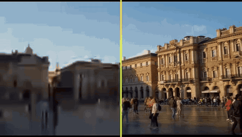
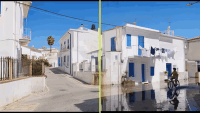
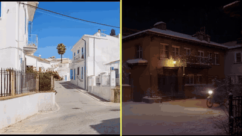
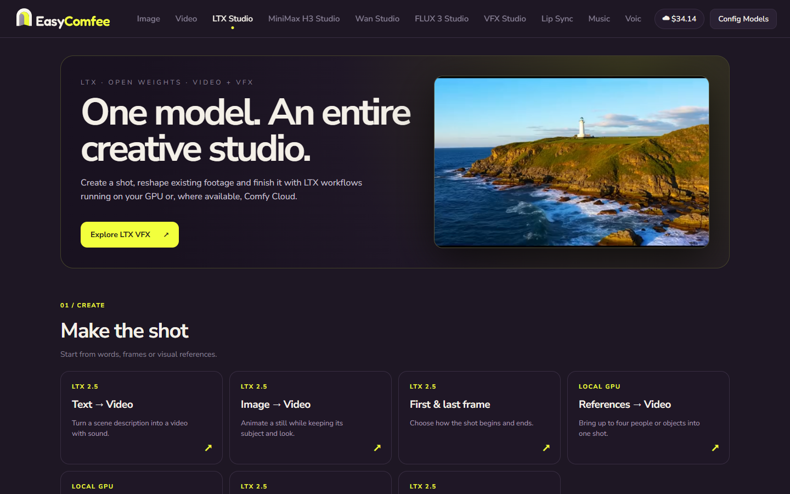
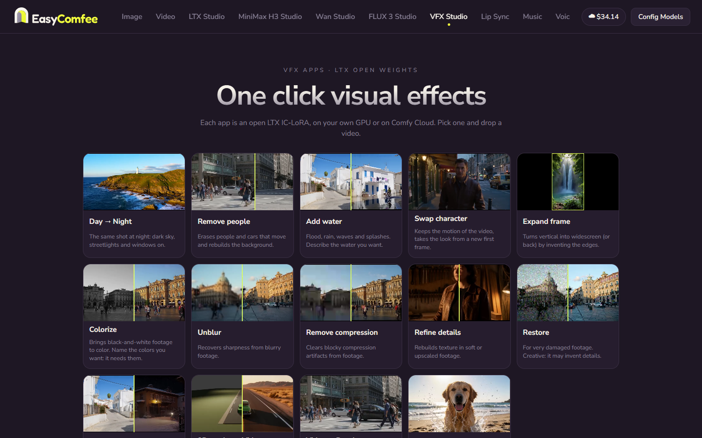
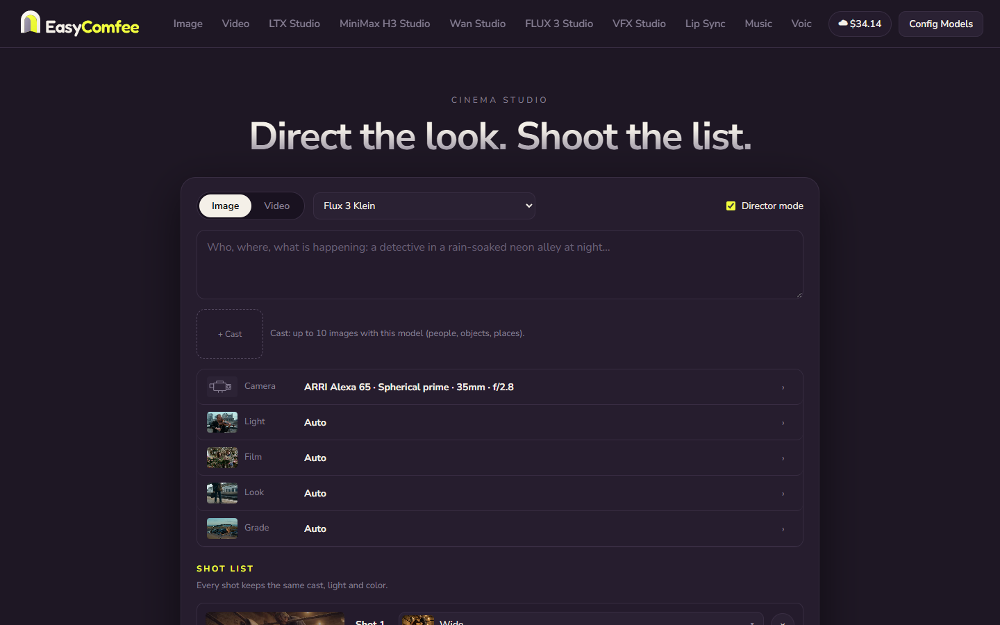
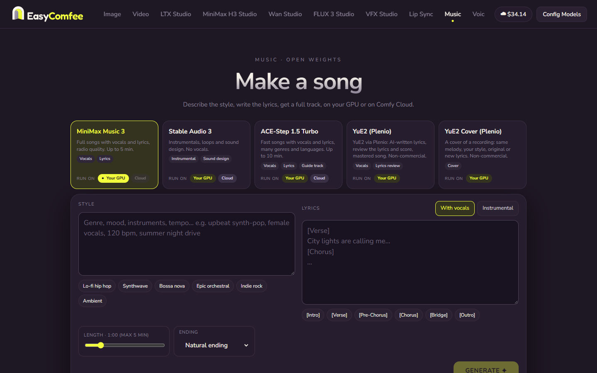

# EasyComfee

**An open-source, Higgsfield-style creative studio that runs on ComfyUI, on your own GPU or on Comfy Cloud.**

EasyComfee puts a clean, one-prompt interface in front of ComfyUI. You pick a mode, type a line or drop a file, and press Generate: no node graph needed (it is still one tab away, in **Advanced**). Open-weight models come first, and a built-in installer downloads exactly the models and custom nodes each feature needs, so it also works on small graphics cards.

LTX is the core of the app: video, keyframes, VFX, camera moves, lip sync and the open Genjutsu (Recast) all run on Lightricks' open LTX models.

### Made with the app (before → after, open LTX models on a 16 GB GPU)

| Day → Night | 3D render → Video | Remove compression |
|---|---|---|
|  |  |  |
| **Add water** | **Expand frame** (inside the green box is the original vertical clip) | **Follow depth** |
|  |  |  |

### The studio

| LTX Studio | VFX Apps |
|---|---|
|  |  |
| **Cinema Studio** | **Music** |
|  |  |

---

## What it does

| Tab | What you get | Models |
|---|---|---|
| **Image** | Text to image, with up to 3 reference images (@image1…) | Krea 2, Kroma, Qwen Image 2.1, Flux 2 Klein, FLUX 3 Klein, Z-Image, Mage, Ideogram 4 · light: FLUX.1 schnell, SD 3.5 Medium, SDXL, SD 1.5 |
| **Video** | Text → video, image → video, first & last frame, references (up to 4 people/objects), keyframes, with sound | LTX 2.5 · LTX 2.3 · MiniMax H3 · FastH3 · light: LTX-Video 2B, Wan 2.2 5B, Wan 2.1 1.3B |
| **LTX Studio** | Every LTX workflow in one place, with its own screens: **Keyframes** on a timeline (drag images to the second they should appear), **Ingredients** (a shot built from several images), **Latent upscale** | LTX 2.5 / 2.3 |
| **Lip Sync** | A portrait and a voice track become a talking video, up to 30 s | LTX 2.3 |
| **Music** | Songs from a style, with your lyrics or instrumental: BPM, key, voice, guide track, lyrics/score review | MiniMax Music 3 · ACE-Step 1.5 · Stable Audio 3 · YuE2 |
| **Voice** | Narrate a text, design a voice, or clone one from a short sample | OmniVoice (local) · Qwen3-TTS (Comfy Cloud) |
| **Cinema Studio** | Direct the shot like a film set: camera, lens, light, film, look and grade cards, shot list, cast, Director mode | Image models + LTX |
| **Genjutsu** | Swap a character in a video, keeping motion, camera and timing | **Recast** (Qwen Image Edit + LTX Union Control) · Wan Animate 2 · Wan 2.2 Animate Replace · MiniMax H3 Character Swap |
| **VFX Studio** | One-click effects on your own footage: Day → Night, Remove people, Add water, Swap character, Expand frame, Colorize, Unblur, Remove compression, Refine details, Restore, Follow depth, 3D render → Video, Slow motion, **Video → Depth map** (video or EXR frames) | LTX 2.5 / 2.3 IC-LoRAs · Video Depth Anything |
| **Assets** | Everything you made | |
| **Advanced** | ComfyUI itself, with its node editor, inside the app | |

Every Generate button shows the price before you press it: *Free* on your GPU, or the estimated Comfy Cloud cost. A progress indicator in the top bar shows the current stage, steps, time and GPU use. Drag any image from a gallery onto a prompt box (or press **↑ Use**) to reuse it as a reference.

### Recast, the open Genjutsu

1. **Qwen Image Edit** redraws the video's first frame with your references (the new character, and optionally a new location), keeping the composition and pose.
2. **LTX** (LTX 2.5 with the LTX 2.3 Union Control IC-LoRA) carries the whole video to that new look, following the original's pose or depth. The original audio is kept.

**MiniMax H3 Character Swap** is [MDMZ](https://www.patreon.com/MDMZ)'s workflow: download his free file `H3_Character_Swap_MDMZ_v1.json` from [this post](https://www.patreon.com/MDMZ/posts/h3-character-172119619) and put it in `backend/terceiros/` (it is not redistributed here).

## Local or Comfy Cloud

Every model menu has two groups:

- **Local · your GPU**: free and private. Models that aren't installed yet are greyed out with *(install it in Config Models)*.
- **Comfy Cloud · credits**: no GPU needed. Open models run on Comfy Cloud's GPUs, billed to your own Comfy account; paid partner models are marked *(API)*.

Picking a model from the other group switches the engine. To use Comfy Cloud, open **Config Models → Comfy Cloud API**, press **Sign in to Comfy and create a key**, and paste the key. It is stored only on your computer (`backend/chaves.json`, never committed, never printed). Your balance shows in the top bar.

### Open weights only

Paid partner models (Kling, Veo, Seedance, Runway, Nano Banana…) are **off by default**: `"so_modelos_abertos": true` in `config.json` hides them and the server refuses them. Turn them on in **Config Models → Comfy Cloud API → Paid API models**.

## Install models in one click

Open **Config Models → Local models**:

1. **Your machine.** The app reads your GPU, VRAM, RAM and free disk from ComfyUI.
2. **Packages.** Each feature is a package. Every card says whether it **runs well**, is **limited** or **won't run** on your machine, with its size, license, source links and the files already present. Light packages (SD 1.5 from 4 GB, SDXL and LTX-Video 2B from 6 GB, Wan from 8 GB) make the app usable on small cards.
3. **Download.** Files come straight from Hugging Face into the exact ComfyUI subfolders the workflows expect. Downloads resume if interrupted.
4. **Custom nodes.** Missing node packs are installed at pinned versions. Then restart ComfyUI once.

## Requirements

- **Windows 10/11.** Linux/macOS work with the manual steps below.
- **GPU:** from 4 GB with the light models; 16 GB and 32 GB+ of RAM for LTX 2.5. No GPU at all? Use Comfy Cloud.
- **ComfyUI:** the one you already have (ComfyUI Desktop, the portable build or a manual install), or none: the installer can download the official portable ComfyUI for you (about 2 GB).
- **Three free programs, installed before you download EasyComfee:**

| Program | Version | Why | Download |
|---|---|---|---|
| **Git** | any recent | downloads EasyComfee and its updates (the **Update** button uses it) | [git-scm.com](https://git-scm.com/download/win) |
| **Python** | **3.11, 3.12 or 3.13** (not 3.14 yet) | runs the studio | [python.org](https://www.python.org/downloads/) |
| **Node.js** | **20 or newer** (the LTS version) | builds the interface once, during install and updates | [nodejs.org](https://nodejs.org/) |

When installing Python, tick **"Add python.exe to PATH"** on the first screen. Git and Node.js are fine with the default options.

**Quicker:** in Windows Terminal (or PowerShell), these three lines install all of them:

```bat
winget install --id Git.Git -e
winget install --id Python.Python.3.12 -e
winget install --id OpenJS.NodeJS.LTS -e
```

Then **close and reopen** the terminal. To check, each of these should print a version (`py` is the Python launcher that `install.bat` uses):

```bat
git --version
py --version
node --version
```

### AMD, Mac and other GPUs

Local generation was built and tested on **NVIDIA RTX cards on Windows** only.

- **Comfy Cloud mode works on any computer** (AMD, Apple Silicon Mac, laptops without a GPU): generations run on Comfy's GPUs, billed to your credits.
- **Locally on AMD or Mac**, ComfyUI itself runs, but many model files in the catalog use NVIDIA-oriented formats: *nvfp4* needs an RTX 50-series card, *fp8* is fast only on RTX 40/50 and may fail on Mac, and the *int8* files rely on ComfyUI kernels written for NVIDIA. The NVIDIA RTX video effects (RTX upscale and smooth motion) are NVIDIA-only. The light models (SD 1.5, SDXL) are the most likely to work, and video models are very slow on Mac.
- `install.bat` is Windows-only; on Mac or Linux follow the manual setup below.

**Config Models** says so: pick an AMD card in *Your machine* and the packages read *Not tested on AMD* instead of *Runs well here*. Reports from AMD and Mac users are welcome.

## Quick start (Windows)

Open a terminal in the folder where you want EasyComfee (for example, in File Explorer open *Documents*, click the address bar, type `cmd` and press Enter), then run:

```bat
git clone https://github.com/sintetizacom/easycomfee.git easycomfee
cd easycomfee
install.bat
```

`install.bat` does the rest:

1. **Finds your ComfyUI** (ComfyUI Desktop, the portable build or a manual install) and writes its folder into `config.json`. If it finds more than one, it asks which. If it finds none, it offers to download the official portable ComfyUI into the EasyComfee folder (about 2 GB, checked against Comfy's published checksum).
2. Creates the Python environment and builds the interface.
3. Puts an **EasyComfee** shortcut with the app icon on your Desktop and in the Start menu (run `criar-atalho.bat` to recreate it).

**Starting the studio.** Open the **EasyComfee** shortcut (or run `start.bat`). A black window opens: it is the studio's server, **keep it open** while you use the app (closing it closes the studio). Your browser opens <http://127.0.0.1:8600> by itself as soon as the server answers.

- If EasyComfee installed ComfyUI, it starts it for you. Right after turning the PC on, ComfyUI takes a minute or two to load; a strip at the top says *ComfyUI is starting* and goes away by itself, and the model menus fill in on their own.
- If you use your own ComfyUI, start it first, as usual.
- **Start ComfyUI with Windows** (Config Models → Local models, when EasyComfee installed ComfyUI): an On/Off switch that loads ComfyUI while the PC starts, so it is ready when you open the studio. Off removes it; it also shows in Task Manager → Startup apps.

Then open **Config Models** and install a package: *Z-Image* (or *SD 1.5* on a small card) plus *LTX 2.5 Video* is a good first pick.

### Updating

When a new version is on GitHub, an **Update available** button shows in the top bar (the studio checks when it opens, every 15 minutes and when you come back to its tab). Press it: the studio closes, a window downloads the new version (`git pull`), updates the Python packages and rebuilds the interface, then the studio comes back in a minimized window and the page reloads by itself. Your Comfy key, gallery, `config.json` and downloaded models are not touched. The button refuses while something is generating. Without an internet connection it says so and changes nothing; the update window also checks the connection before it touches anything, and if the connection drops halfway, double-click `atualizar.bat` in the EasyComfee folder to finish.

The button needs an install made with `git clone` from GitHub. If you downloaded a .zip, update by downloading the new version, or run `git pull` and `install.bat` by hand.

### Manual setup (any OS)

```bash
python -m venv backend/.venv
backend/.venv/bin/pip install -r backend/requirements.txt      # Windows: backend\.venv\Scripts\pip
cd frontend && npm ci && npm run build && cd ..
cp config.example.json config.json                             # then edit comfy_dir
cd backend && .venv/bin/python -m uvicorn app:app --host 127.0.0.1 --port 8600
```

## Configuration

`config.json` (every key can also be set as an upper-case environment variable):

| Key | Meaning |
|---|---|
| `comfy_url` | Address of your ComfyUI server |
| `comfy_dir` | Your ComfyUI folder. Models, inputs and outputs live here. |
| `comfy_url_flux3`, `comfy_dir_flux3` | Optional second ComfyUI (a newer version) for the features whose nodes need it. Leave empty to use one ComfyUI for everything. |
| `comfy_codigo_dir` | Only if the running ComfyUI code lives in a different folder than `comfy_dir` |
| `modelos_dir` | Where models are downloaded (default: `comfy_dir/models`) |
| `comfy_entrada`, `comfy_saida` | Custom input/output folders, if ComfyUI runs with `--input-directory` / `--output-directory` |
| `app_porta` | Port of the studio (default 8600) |
| `so_modelos_abertos` | `true`: only open-weight models |
| `link_recarga` | Where "top up credits" links point |
| `hf_token` | Hugging Face token for gated repositories (it can also be entered in Config Models) |

To show ComfyUI inside the **Advanced** tab, start ComfyUI with `--enable-cors-header http://127.0.0.1:8600` (Firefox blocks it otherwise).

## ComfyUI workflows

[`comfy_workflows/`](comfy_workflows/) has the graphs the app sends to ComfyUI, one JSON per feature, in ComfyUI's API format. Drag one onto the ComfyUI canvas to open it. They are generated from the app's own builders by `scripts/exportar_workflows.py`.

## How it works

- **`backend/`**: FastAPI. Each mode builds a ComfyUI API graph in Python (`workflows.py`, `videos_leves.py`, `ltx23.py`, `avatar.py`, `genjutsu.py`, `musica.py`, `voz.py`), queues it on ComfyUI and streams progress back over a WebSocket. In cloud mode, `nuvem.py` maps model file names to the cloud's, uploads inputs and downloads outputs. `precos.py` estimates costs: the price formula Comfy publishes for each API node, or expected GPU time × the per-second rate for open models on the cloud.
- **`catalogo/pacotes.json`**: every model file the code asks for, with its subfolder, Hugging Face source, size, license and memory needs, generated by `scripts/gerar_catalogo.py`. A test fails if a workflow references a file that isn't in the catalog.
- **`catalogo/nos.json`**: custom node packs, pinned to registry versions or git commits.
- **`frontend/`**: React and TypeScript (Vite); the studio is in `src/estudio/`.

Run the tests with `cd backend && .venv/Scripts/python -m pip install -r requirements-dev.txt && .venv/Scripts/python -m pytest testes` (the first part installs pytest, once).

## License

The studio's code is released under the [MIT License](LICENSE). Models are not part of this repository: each one is downloaded from its own source under its own license, shown on its package card.

### Model licenses

**Read the license before using outputs commercially.** Several open models restrict commercial use. Licenses as published on Hugging Face (checked 23–27/10/2026):

| Model | Used for | License |
|---|---|---|
| LTX 2.5 (Lightricks) | Video, VFX, Cinema Studio, Recast | [LTX-2.x Community License](https://github.com/Lightricks/LTX-2/blob/main/LICENSE-2_x) |
| LTX 2.3 (Lightricks) | Video, Lip Sync, Union Control, In/Outpainting | [LTX-2 Community License](https://github.com/Lightricks/LTX-2/blob/main/LICENSE-2) |
| LTX-Video 2B 0.9.8 | Light video | Apache 2.0 / LTX-Video license |
| MiniMax H3 · FastH3 | Video, Character Swap | [MiniMax H3 Community License](https://huggingface.co/MiniMaxAI/MiniMax-H3/blob/main/LICENSE) |
| Wan 2.2 5B · Wan 2.1 1.3B · Wan Animate | Light video, Genjutsu | Apache 2.0 |
| Qwen Image Edit 2511 | Recast first frame, editing | Apache 2.0 |
| Qwen Image 2.1 | Image | [Qwen Research License](https://huggingface.co/Qwen/Qwen-Image-2.1/blob/main/LICENSE) (non-commercial) |
| Z-Image Turbo | Image | Apache 2.0 |
| Krea 2 / Kroma | Image | [Krea 2 Community License](https://huggingface.co/krea/Krea-2-Turbo/blob/main/LICENSE.pdf) |
| FLUX 3 Klein | Image | FLUX Kommunity License |
| FLUX 2 Klein 9B | Image | Apache 2.0 or FLUX non-commercial, depending on the variant |
| FLUX.1 schnell | Light image | Apache 2.0 |
| SD 3.5 Medium | Light image | Stability AI Community License (free under US$1M yearly revenue) |
| SDXL (RealVisXL 5) | Light image | CreativeML OpenRAIL++-M |
| SD 1.5 (DreamShaper 8) | Light image | CreativeML OpenRAIL-M |
| Mage Flow | Image | MIT |
| Ideogram 4 (open weights) | Image | [Ideogram Non-Commercial Model Agreement](https://huggingface.co/ideogram-ai/ideogram-4-fp8/blob/main/LICENSE.md) |
| Video Depth Anything Small | Depth map, Follow depth | Apache 2.0 |
| MiniMax Music 3 · ACE-Step 1.5 | Music | Apache 2.0 |
| Stable Audio 3 | Music, sound | [Stability AI Community License](https://huggingface.co/stabilityai/stable-audio-open-1.0/blob/main/LICENSE.md) |
| YuE2 / SheetSage2 | Music | CC BY-NC 4.0 (non-commercial) |
| OmniVoice | Voice (local) | Code Apache 2.0, **model CC BY-NC** (non-commercial) |
| Qwen3-TTS | Voice (Comfy Cloud) | Apache 2.0 |
| SeedVR2 and upscalers | Upscaling | Apache 2.0, BSD-3 or CC BY-NC-SA 4.0, depending on the model |

Partner models reached through Comfy's API nodes (only when enabled) follow their providers' terms.

## Credits

Built on [ComfyUI](https://github.com/comfyanonymous/ComfyUI) and open models by Lightricks (LTX), MiniMax, Alibaba (Wan, Qwen), Tongyi-MAI (Z-Image), Krea, Black Forest Labs, Stability AI, ACE Studio (ACE-Step), Depth Anything, k2-fsa (OmniVoice) and others. Workflows follow Comfy's official templates where one exists. The interface is inspired by Higgsfield and by [Open Generative AI](https://github.com/Anil-matcha/Open-Generative-AI).

Made for the Comfy **Open Source Higgsfield** challenge. #OpenSourceHiggsfield
