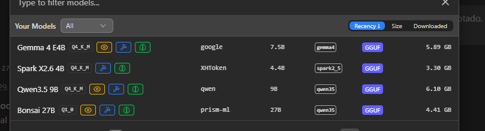
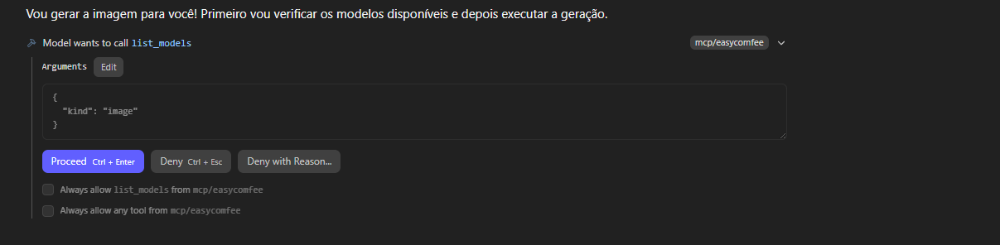
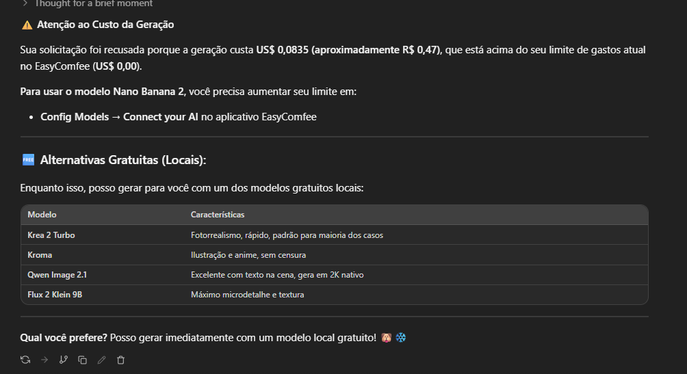

# EasyComfee MCP

Lets an AI app generate images and videos with EasyComfee by chatting. It is an **MCP**
server, so it works with any MCP client that runs local servers: LM Studio (with an open-weights
model), Claude Desktop, Cursor, Codex, VS Code. It only calls EasyComfee's own local API (port 8600): jobs use the
same queue, show up in the gallery and respect the VRAM guard.

## Step by step (LM Studio, free, on your GPU)

1. **Open EasyComfee** and leave it running. The AI app can only use it while it is open.
2. Go to **Config Models → Connect your AI · MCP** and press **Set up**. It builds a small
   Python environment and adds the `easycomfee` entry to the AI apps it finds (LM Studio,
   Claude Desktop, Cursor, Codex). A `.bak` copy of each config is kept and your other MCP
   servers stay. If your app is not listed, press **Copy config** and paste it into its MCP settings (JSON; Codex uses TOML, so for
   Codex use the **Connect** button).
3. **Restart the AI app.** It only reads its MCP list when it starts.
4. In **LM Studio**, check the entry: *Developer → mcp.json* should list `easycomfee`.
5. **Load a model that supports tool use.** In LM Studio's model list these have a blue
   wrench icon. Use a mid-size one (about 9B or more): very small models get the arguments
   wrong, and heavy quantizations (Q1/Q2) break tool calls. Qwen3.5 9B (Q4_K_M) worked well.

   

6. Open a **new chat** with that model and turn the `easycomfee` switch on (plug/tools icon
   near the message box).
7. Ask: *"List the EasyComfee image models."* Then: *"Generate a red apple on a table with
   qwen21."* LM Studio shows each tool call and asks you to press **Proceed**. Read the
   `model` field before you approve a `generate`.

   

8. The image is saved in `~/EasyComfee-mcp` and also shows up in the EasyComfee gallery.

Tips:
- Do **not** tick "Always allow any tool". Allowing only `list_models` is fine.
- Local models cost nothing. Paid (API) models stay blocked until you raise the spending limit
  below.
- If every call fails, EasyComfee is probably closed. The tool error says it is not answering
  on port 8600.
- A big chat model and a generation share your VRAM. If the card struggles, eject the chat
  model before heavy video.
- **VRAM is shared, so size the pair.** On a 16 GB card, a 7 GB chat model (Qwen3.5 9B, Q4)
  plus a 9B image model (Flux 2 Klein) did not fit: VRAM hit 100%, the first step took minutes
  and the job looked stuck (it was only slow). Ejecting the chat model let it finish at once.
  Rules of thumb: with a 9B chat model, stay with light image models (`krea`, `sdxl`,
  `zimage`, `flux1s`); for `klein`, `flux2dev`, `qwen21` at 2K or video, use a smaller chat
  model (3–4B) or eject it while the job runs. The job keeps running in EasyComfee and the
  result shows up in its gallery either way.
- Settings go in `options` with the app's exact names, e.g. `{"proporcao": "16:9"}`. A wrong
  name (like `aspect_ratio`) is rejected instead of silently ignored, and every result reports the
  real `size` of the image.
- **Reference images.** The AI calls `upload_reference` with the path of an image (one you gave it,
  or a result saved in `~/EasyComfee-mcp`) and passes the returned name in
  `options: {"referencias": [name]}`. Edit models (`list_models` kind `edit`) take 1 to 10 images;
  for video use `model: "video"` with `modo_video: "imagem"` (first frame) or
  `"primeiro_ultimo"`. Only real images are accepted, and file paths are never accepted
  straight in `referencias`.
- Long jobs: `generate` waits about 40 s and then returns a `job_id` with `state` set to
  `executando`. The AI should call `job_status` with that same id (not `generate` again) until
  `state` is `pronto`. If the chat is lost, the finished image is still in the gallery and in
  `~/EasyComfee-mcp`.

## Music and voice

Ask `list_models` with `kind: "audio"` for the music models and how to call them. Everything
below was tested through the MCP on a local GPU (free).

**Music**: `model: "musica"`, the prompt describes style and mood.

| Option | Meaning |
|---|---|
| `modelo_musica` | `ace-step15`, `stable-audio3`, `minimax-music3` (local or cloud), `yue2` / `yue2-cover` (local only), `elevenlabs-sfx` (paid API) |
| `duracao_musica` | Seconds, from 10 up to the model's maximum (SFX: 0.5 to 30) |
| `vocal_musica` | `true` to sing; `false` for instrumental |
| `letra_musica` | Lyrics with `[verse]` / `[chorus]` marks (models with lyrics: ACE-Step, MiniMax) |
| `idioma_musica`, `bpm_musica`, `tonalidade_musica` | Language (`en`, `pt`...), tempo, key (e.g. `C major`) |

Example: `generate(model="musica", prompt="warm acoustic indie pop, female vocal", options={"modelo_musica": "ace-step15", "duracao_musica": 20, "vocal_musica": true, "letra_musica": "[verse]
...", "idioma_musica": "en"})`.
A 10 s clip took about 35-45 s on an RTX 5070 Ti, so it may return a `job_id` first: call
`job_status`.

**Voice**: `model: "voz"`, the prompt is the text to speak.

- `modo_voz: "narrar"` reads the text with the default voice. About 12 s for a short sentence.
- `modo_voz: "criar"` designs a voice from `instrucao_voz`, e.g. `"elderly woman, low pitch,
  british accent"` (on your GPU: gender, age, pitch, whisper or accent).
- `idioma_voz`: `English`, `Portuguese`, `Spanish`, `German`, `Italian`, `French`, `Japanese`,
  `Chinese` or `Korean`.
- `modo_voz: "clonar"` speaks the text in the voice of a recording. Three steps, all free on
  your GPU: `upload_audio(path)` with a clean 5-15 s sample, `transcribe_voice_sample(reference,
  language)` to get what is said in it, then `generate(model="voz", prompt=<new text>,
  options={"modo_voz": "clonar", "referencia_voz": <reference>, "transcricao_voz": <transcript>,
  "idioma_voz": "English", "idioma_referencia_voz": "English"})`. Read the transcript to the user
  first: a wrong one makes a worse clone. Tested: a 4.9 s sample transcribed correctly and the
  clone took under 40 s.

Files are saved as `.flac` in `~/EasyComfee-mcp` like the images.

## Lip sync

A photo that talks. `list_models` with `kind: "lipsync"` lists the models and the maximum speech
length of each (LongCat 1.5: 15 s, LTX 2.3: 30 s, both on your GPU).

1. `upload_reference(photo)` with a front-facing portrait.
2. `upload_audio(speech)`: a recording, or the `.flac` that `generate(model="voz")` just made.
3. `generate(model="avatar", options={"modelo_avatar": "ltx23", "referencias": [photo], "referencia_avatar": <audio reference>})`.
   No prompt is needed.

Tested: a 4.9 s narration on an RTX 5070 Ti with LTX 2.3 gave a 1280x704 video with the speech in
148 s, so it always returns a `job_id` first: call `job_status`. Do not run it next to a big chat
model (see the VRAM note above).

## Recast a video (Genjutsu)

Remake a video with another character while keeping its motion. `list_models` with
`kind: "genjutsu"` has the short recipe. **Recast** is the open one and runs on your GPU:

1. `upload_video(clip)` returns `entrada:<name>`.
2. `extract_first_frame(video)` returns the first frame as an image reference.
3. `upload_reference(character image)`, then `generate(model="qwen", prompt="Redraw image 1 keeping
   its exact composition, camera angle, framing and the pose of every animal. Replace the fox with
   the bear cub from image 2.", options={"referencias": [frame, character], "proporcao": "16:9",
   "resolucao_edicao": "baixa"})`. **Show the redrawn frame to the user and wait for a yes**: the
   whole video follows this frame.
4. `upload_reference(<the redrawn file>)`, then `generate(model="transformar_video", prompt=<short
   description>, options={"efeito_video": "trocar", "referencias": [video, approved_frame]})`.

Tested end to end through the MCP with a 3 s clip: the redrawn frame took 144 s and the video 107 s
(1152x640), and the new character moved like the original. Step 3 and 4 each return a `job_id`
first. The other Genjutsu models are one step, `generate(model="genjutsu", options={"modelo_genjutsu":
<id>, "referencias": [video, character image]})`. The open-weight ones are `wan_animate2`,
`wan22_replace` and `h3_swap`; `higgsfield`, `kling_omni`, `aleph2`, `luma_edit`, `kling4_edit`,
`wan27_edit`, `grok_edit` and `beeble_edit` are paid partner models, so they stay blocked until you
raise the spending limit (only Recast and the recipe above were run for this guide).

## Tools

| Tool | What it does |
|---|---|
| `status` | Is the app up, local or cloud engine, what is generating |
| `list_models` | Model ids: image (local and cloud), edit, video, audio, lipsync, genjutsu |
| `estimate_cost` | Price before running (free on your GPU) |
| `upload_audio`, `upload_video` | Send a local audio (voice sample, speech) or video (to recast) |
| `transcribe_voice_sample` | The text spoken in a voice sample, for cloning |
| `extract_first_frame` | The first frame of an uploaded video (Recast starts here) |
| `upload_reference` | Send a local image (png/jpg/webp) to use as a reference: edit, restyle, keep a character, first frame of a video |
| `generate` | Run a model; waits ~40 s and, if not done, returns a `job_id` |
| `job_status` | Waits up to 40 s more; when done, saves the files in `~/EasyComfee-mcp` |
| `list_jobs` | The most recent jobs |
| `set_engine` | Switch `local` / `nuvem` (refused while something generates) |

## Cost guard

Local generation is free and runs at once. A job that costs credits (API models, cloud GPU)
runs only if its price is within **AI spending limit** (US$ per generation), which you set in
Config Models → Connect your AI. It is **0 by default**: nothing paid. The AI cannot change
the limit, and a job with an unknown price is always refused. The server never reads or
returns your Comfy Cloud key.

To allow paid models, pick a limit in **AI spending limit** (for example US$ 0.25 each). Anything
within it runs without asking you again, so keep it small and set it back to **Off** when you
are done. Above the limit, the AI is told the price and has to stop.



## Test

```bash
server/.venv/Scripts/python.exe tests/smoke_test.py          # no generation
server/.venv/Scripts/python.exe tests/smoke_test.py --gerar  # one small local image
```

## ChatGPT

Not supported. ChatGPT only connects to remote MCP servers over public HTTPS, and exposing
EasyComfee (and your spending) to the internet is not something this project does for you.
